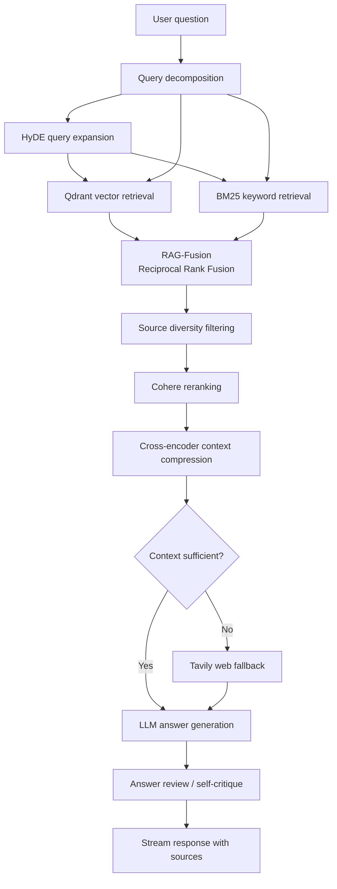

# Orchestrated RAG — Advanced Retrieval-Augmented Generation

A document question-answering project that combines multiple retrieval and reasoning techniques to answer questions grounded in a user's own files. It includes a FastAPI backend, browser-based chat interface, streaming responses, and source attribution.

The project explores how hybrid search, query expansion, reranking, context filtering, and fallback retrieval work together in a multi-stage RAG workflow.


## Project Highlights

- **Hybrid retrieval:** combines Qdrant vector search with BM25 keyword search.
- **Query decomposition and HyDE:** expands complex questions and improves semantic retrieval coverage.
- **RAG-Fusion:** merges ranked results from multiple retrieval queries using reciprocal rank fusion.
- **Contextual enrichment:** adds document-level context to chunks during ingestion.
- **Reranking:** uses Cohere reranking to improve the ordering of retrieved passages.
- **Context compression:** uses a cross-encoder to retain query-relevant sentences.
- **CRAG-style fallback:** can use Tavily web search when document context is insufficient.
- **Answer review:** includes a self-critique stage intended to identify unsupported responses.
- **Streaming interface:** FastAPI streams answers to a browser UI with conversation history and source information.

## Technology Stack

| Area | Technologies |
|---|---|
| Language | Python |
| API server | FastAPI |
| RAG orchestration | LlamaIndex |
| Vector database | Qdrant |
| Keyword retrieval | BM25 |
| Embeddings | BAAI/bge-large-en-v1.5 |
| Reranking | Cohere |
| LLM providers | Groq, OpenRouter / NVIDIA |
| Web fallback | Tavily |
| Document parsing | Docling (optional advanced parsing) |
| Interface | HTML, CSS and JavaScript |

## System Architecture

The diagram below summarizes the main flow implemented by the project. Some stages, such as query decomposition and web fallback, are conditional on the query and pipeline configuration.



For a component-by-component explanation, see [Architecture Notes](project_docs/ARCHITECTURE.md).

## Repository Structure

```text
.
├── project_docs/        # Architecture, provenance and evaluation documentation
├── evaluation/          # Independent retrieval metrics, sample data and unit tests
├── .env.example         # Placeholder environment configuration
├── docs/                # Documents supplied for ingestion at runtime
├── config.py            # Model, retrieval and application configuration
├── ingest.py            # Document parsing, enrichment and indexing
├── pipeline.py          # Multi-stage retrieval and generation pipeline
├── query.py             # Terminal Q&A interface
├── server.py            # FastAPI server and streaming endpoint
├── app.html             # Browser chat interface
├── landing.html         # Project landing page
├── tests.py             # Question-based regression/evaluation runner
├── requirements.txt     # Python dependencies
└── README.md
```

Generated vector stores, caches, test outputs, local documents, and secrets should remain local unless intentionally prepared for sharing.

## Getting Started

### 1. Clone the repository

```bash
git clone https://github.com/Mannn2105/Advanced-Rag-Pipeline-.git
cd Advanced-Rag-Pipeline-
```

### 2. Create and activate a virtual environment

```bash
python -m venv .venv
```

Windows PowerShell:

```powershell
.venv\\Scripts\\Activate.ps1
```

macOS / Linux:

```bash
source .venv/bin/activate
```

### 3. Install dependencies

```bash
pip install -r requirements.txt
```

For optional structure-aware parsing with Docling, install the additional packages noted in the project setup:

```bash
pip install docling llama-index-readers-docling llama-index-node-parser-docling
```

### 4. Configure API keys

Create a local `.env` file in the project root. Add the credentials for the providers and services enabled in your configuration:

```dotenv
GROQ_API_KEY=your_groq_key
OPENROUTER_API_KEY=your_openrouter_key
COHERE_API_KEY=your_cohere_key
TAVILY_API_KEY=your_tavily_key
```

Never commit real API keys. Keep `.env` private and use `.env.example` with placeholders if sharing configuration.

### 5. Add documents and build the index

Place supported files (PDF, DOCX, TXT, Markdown, or CSV) in the runtime `docs/` directory, then run:

```bash
python ingest.py
```

### 6. Run the application

```bash
python server.py
```

Open [http://localhost:8000](http://localhost:8000).

For terminal-based question answering:

```bash
python query.py
```

## Configuration

The main configuration is managed in `config.py`. These are the defaults currently defined in the repository:

| Setting | Default | Purpose |
|---|---|---|
| `GROQ_MODEL` | `llama-3.1-8b-instant` | Supporting pipeline tasks |
| `OPENROUTER_MODEL` | `nvidia/nemotron-3-super-120b-a12b:free` | Answer generation |
| `EMBED_MODEL` | `BAAI/bge-large-en-v1.5` | Local embedding model |
| `COHERE_RERANK` | `rerank-english-v3.0` | Reranking |
| `VECTOR_TOP_K` | `15` | Vector retrieval candidates |
| `BM25_TOP_K` | `10` | BM25 retrieval candidates |
| `RERANK_TOP_N` | `8` | Candidates retained after reranking |
| `CHUNK_SIZE` | `512` | Fallback chunk size |
| `VERBOSE` | `True` | Pipeline logging |

Check `config.py` for the authoritative settings and provider requirements.

## Tests and Evaluation

Run the project's question-based regression/evaluation runner:

```bash
python tests.py
```

Run a specific test group or test ID using the runner's supported arguments:

```bash
python tests.py --group R
python tests.py --test R-01
```

The test runner queries the configured pipeline and therefore requires the local index, documents, and relevant provider credentials to be set up. A successful run has not been claimed as part of this repository documentation update. The independent retrieval-metrics utility does not need provider credentials; see [Evaluation tooling](evaluation/README.md).

See [Evaluation Guide](project_docs/EVALUATION.md) for a reproducible comparison plan, metric definitions, and a results template. Do not present the historical 35–49% contextual-retrieval figure as a benchmark measured by this project: it is a research-reported result, not independently verified here.

## Security and Responsible Use

- Keep API keys in environment variables and out of source control.
- Treat retrieved documents and web results as untrusted input.
- Review source passages for important decisions; retrieval and self-critique do not guarantee factual correctness.
- Apply authentication, rate limits, and appropriate access controls before exposing the server beyond a trusted local environment.
- Avoid indexing confidential or personal documents unless you have permission and understand where embeddings and provider requests are processed.

## What This Project Demonstrates

- Building a multi-stage RAG pipeline in Python.
- Combining vector and keyword retrieval.
- Applying query expansion, reciprocal rank fusion, reranking, and context compression.
- Integrating model providers and external search APIs.
- Exposing an AI workflow through FastAPI and a streaming web interface.
- Designing regression questions and evaluating retrieval quality.

## License status

This repository currently has no `LICENSE` file. Do not assume the code is MIT-licensed or grant reuse rights until the project owner has selected and added an appropriate license. The reference repository reviewed during the project audit also has no declared license; obtain permission before reusing its code.

---

Built with Python, LlamaIndex, Qdrant, FastAPI, and modern retrieval techniques.
