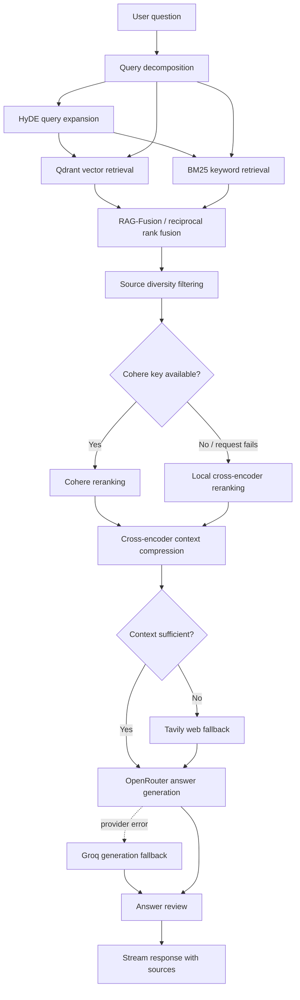

# Advanced RAG Pipeline

A Python-based document question-answering system that combines dense and sparse retrieval, query expansion, reranking, context compression, and answer generation. The project exposes the pipeline through a **FastAPI backend** and a browser-based chat interface with streaming responses and source attribution.

<p align="center">
  <a href="https://github.com/Mannn2105/Advanced-Rag-Pipeline-"><strong>Source code</strong></a>
</p>

## What it demonstrates

- **Hybrid retrieval:** combines Qdrant vector search with BM25 keyword search.
- **Query expansion:** uses HyDE and query decomposition to improve retrieval coverage.
- **RAG-Fusion:** merges results from multiple searches using reciprocal rank fusion.
- **Contextual enrichment:** adds document-level context to chunks during ingestion.
- **Reranking:** uses Cohere when a valid `COHERE_API_KEY` is configured; otherwise, or if the Cohere request fails, it falls back to the local cross-encoder reranker.
- **Context compression:** uses a cross-encoder to prioritize query-relevant content.
- **Web fallback:** can use Tavily when the configured pipeline determines that document context is insufficient.
- **Answer review:** includes a self-critique stage intended to help identify unsupported answers.
- **Streaming API and UI:** serves responses through FastAPI and a browser chat interface.

## Technology stack

| Area | Technologies |
|---|---|
| Language | Python |
| API | FastAPI |
| RAG framework | LlamaIndex |
| Vector database | Qdrant |
| Keyword retrieval | BM25 |
| Embeddings | BAAI/bge-small-en-v1.5 (configured in `config.py`) |
| Reranking | Cohere API (optional) with local cross-encoder fallback |
| Cross-encoder | `cross-encoder/ms-marco-MiniLM-L-6-v2` |
| Model providers | Groq, OpenRouter |
| Web search fallback | Tavily |
| Document parsing | Docling (optional) |
| Interface | HTML, CSS, JavaScript |

## Architecture

The following diagram summarizes the main workflow. Query decomposition, web fallback, and some enrichment steps depend on the query and configuration.



See [Architecture Notes](project_docs/ARCHITECTURE.md) for more detail.

## Repository structure

```text
.
├── project_docs/        # Architecture and evaluation documentation
├── .env.example         # Placeholder environment configuration
├── docs/                # Documents available for ingestion
├── config.py            # Model, retrieval and application settings
├── ingest.py            # Document parsing, enrichment and indexing
├── pipeline.py          # Retrieval and generation pipeline
├── query.py             # Terminal question-answering interface
├── server.py            # FastAPI server and streaming endpoint
├── app.html             # Browser chat interface
├── landing.html         # Project landing page
├── tests.py             # Question-based regression/evaluation runner
└── requirements.txt     # Python dependencies
```

Generated vector stores, caches, local documents, test outputs, and secrets should remain local unless intentionally prepared for sharing.

## Run locally

### 1. Clone the repository

```bash
git clone https://github.com/Mannn2105/Advanced-Rag-Pipeline-.git
cd Advanced-Rag-Pipeline-
```

### 2. Create a virtual environment

```bash
python -m venv .venv
```

Activate it:

**Windows PowerShell**
```powershell
.venv\Scripts\Activate.ps1
```

**macOS / Linux**
```bash
source .venv/bin/activate
```

### 3. Install dependencies

```bash
pip install -r requirements.txt
```

For optional structure-aware parsing with Docling, install the additional packages documented by the project:

```bash
pip install docling llama-index-readers-docling llama-index-node-parser-docling
```

### 4. Configure environment variables

Create a local `.env` file in the project root. Add only the API credentials for services you intend to use:

```dotenv
GROQ_API_KEY=your_groq_key
OPENROUTER_API_KEY=your_openrouter_key
COHERE_API_KEY=your_cohere_key
TAVILY_API_KEY=your_tavily_key
```

The repository includes `.env.example` with placeholders. Never commit real API keys or paste secrets into issue reports.

### 5. Add documents and build the index

Place supported documents (such as PDF, DOCX, TXT, Markdown, or CSV) in the runtime `docs/` directory, then run:

```bash
python ingest.py
```

### 6. Start the application

```bash
python server.py
```

Open [http://localhost:8000](http://localhost:8000) in your browser.

For terminal-based question answering:

```bash
python query.py
```

## Configuration

The main settings are defined in `config.py`. Current defaults include:

| Setting | Default | Purpose |
|---|---|---|
| `GROQ_MODEL` | `llama-3.1-8b-instant` | Supporting pipeline tasks |
| `OPENROUTER_MODEL` | `nvidia/nemotron-3-super-120b-a12b:free` | Answer generation |
| `EMBED_MODEL` | `BAAI/bge-small-en-v1.5` | Local embedding model |
| `COHERE_RERANK` | `rerank-english-v3.0` | Passage reranking |
| `VECTOR_TOP_K` | `15` | Vector retrieval candidates |
| `BM25_TOP_K` | `10` | BM25 retrieval candidates |
| `RERANK_TOP_N` | `8` | Candidates retained after reranking |
| `CHUNK_SIZE` | `512` | Fallback chunk size |

Check `config.py` for the authoritative settings and provider requirements.

## Tests and evaluation

Run the lightweight unit-test suite used by GitHub Actions:

```bash
python -m unittest discover -s tests -v
```

Run the question-based, corpus-dependent evaluation runner:

```bash
python tests.py
```

The runner may also support selecting a group or test ID:

```bash
python tests.py --group R
python tests.py --test R-01
```

The question-based evaluation requires the local index, source documents, and relevant provider credentials. The unit tests are designed to run without the full production provider stack. Results depend on the selected documents, models, and configuration. Do not interpret research-reported improvements or illustrative figures as benchmark results measured by this repository unless you reproduce and document the experiment.

See [Evaluation Guide](project_docs/EVALUATION.md) for metric definitions and a reproducible comparison plan.

## Hosted smoke tests

Run read-only checks against the deployed app after a release:

```bash
python smoke_test.py --base-url https://your-app.up.railway.app
```

The smoke runner checks application readiness, the persistent document snapshot,
individual reconstructed-text downloads, ZIP archive integrity, source attribution,
grounded answers, conversation continuity, and refusal behavior for an out-of-corpus
question. It does not upload, delete, or re-ingest documents.

If the hosted app uses HTTP Basic authentication, set `APP_USERNAME` and
`APP_PASSWORD` in the shell environment before running the command. The script
prints a pass/fail summary and exits non-zero if any check fails. These checks are
a deployment smoke test, not a substitute for a larger human-reviewed quality
evaluation.

## Security and responsible use

- The hosted app supports shared HTTP Basic authentication through `APP_USERNAME` and `APP_PASSWORD`. Configure both in Railway; if only one is set, protected routes fail closed with HTTP 503. If both are unset, authentication is disabled for local development.
- The `/api/status` endpoint remains public for Railway health checks. The chat UI, query API, conversation endpoints, and document library require valid Basic credentials when authentication is configured.
- This is a shared login, not individual user authentication: it does not provide per-user conversation ownership or document-level permissions.
- Keep credentials in environment variables; never commit a populated `.env` file.
- Treat retrieved documents and web results as untrusted input.
- Review cited source passages for important decisions; retrieval and self-critique do not guarantee factual correctness.
- Add rate limiting and stronger per-user access controls before treating the service as a public multi-user product.
- Do not index confidential or personal documents unless you have permission and understand how embeddings and external providers process the data.

## Limitations and possible improvements

- Retrieval quality depends on document quality, chunking, embeddings, and retrieval configuration.
- External model and reranking services require valid credentials and may have rate or usage limits.
- Evaluation should be repeated on a representative, held-out question set before making quantitative performance claims.
- A production deployment should include authentication, monitoring, persistent storage, and explicit data-retention controls.

## License

No license file is currently included in this repository. Unless a license is added by the relevant rights holder, the source code remains subject to the default copyright rules; do not assume it is MIT-licensed or reuse it under MIT terms.

---

Built with Python, FastAPI, LlamaIndex, Qdrant, and retrieval-augmented generation techniques.
